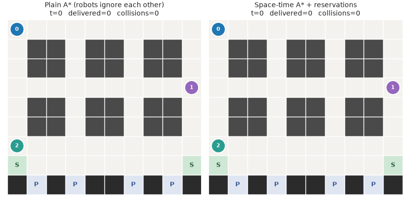

# Multi-Robot Warehouse Fleet

A warehouse robot fleet simulator built from scratch to learn multi-robot planning: task allocation, collision-free path planning, deadlock handling and fleet behaviour.



*Left: every robot plans alone with A* and they drive through each other. Right: the same tasks with space-time A*, a shared reservation table, yielding and parking.*

## Results

3 robots, 300 time steps, task rate 0.3 (busy), averaged over 30 random seeds.

| Version | Delivered | Waiting steps | Runs that freeze | Collisions per run |
|---|---|---|---|---|
| Plain A* (robots ignore each other) | 65.3 | 0.0 | 0 / 30 | **41.1** |
| Space-time A* + reservation table | 42.0 | 327.8 | 9 / 30 | 0 |
| + yielding | 49.0 | 237.1 | 2 / 30 | 0 |
| + parking pockets | 49.4 | 231.4 | 1 / 30 | 0 |
| + short stops at pickups/drop-offs | **63.0** | **4.6** | **0 / 30** | **0** |

Plain A* delivers the most only because driving through other robots costs nothing in the simulator. On real robots, each of those 41 collisions per run would be a crash. The final version gets within about 4% of that number with zero collisions.

When the warehouse is quiet (task rate 0.1), parking cuts waiting steps from 125.4 to 1.8.

## How it works

Every time step, the simulator runs the same loop:

1. **Tasks arrive.** Each task is "pick up next to a shelf, deliver to a station".
2. **Allocation.** Each robot without a task takes the waiting task with the closest pickup (greedy). Robots still without a task drive to a free parking pocket.
3. **Planning.** If anything changed, the whole fleet is replanned together.
4. **Move.** Every robot moves one cell or waits.
5. **Check.** Count deliveries, waiting and collisions.

### Key ideas

- **Space-time A\*.** Robots plan over (cell, time), not just cells, and waiting in place is a valid move.
- **Reservation table.** Robots plan one at a time and book the cells *and the moves* they will use at each time step. Booking moves prevents two robots swapping places through each other.
- **Yielding.** If a robot can't find a path and it's standing on another robot's goal, it moves to a nearby free cell instead. This fixed most deadlocks.
- **Parking pockets.** Idle robots drive to dead-end `P` cells instead of sitting on stations. The simulator checks there is a spot for every robot.
- **Short stops.** The planner books pickups and drop-offs only briefly, because robots leave them right away. Only parking is booked "forever". This removed almost all waiting at stations.
- **Replan on every state change.** Whenever a robot picks up, drops off, goes idle or parks, the fleet replans before anyone moves. If an assumption turns out wrong, nobody acts on it.

## Running it

Requires Python 3.10+.

```
pip install -r requirements.txt

python make_gif.py                                   # watch the fleet live
python make_gif.py --compare                         # plain A* next to the coordinated fleet
python make_gif.py --planner plain --map maps/small_warehouse.txt --no-parking   # the crashing version
python make_gif.py --rate 0.1 --steps 150            # a quiet warehouse
python make_gif.py --compare --save results/compare.gif

python -m experiments.compare_maps                   # 2 vs 4 stations
python -m experiments.compare_parking                # parking on/off, busy and quiet

python -m pytest
```

Map files are plain text: `.` floor, `#` shelf, `S` station, `P` parking pocket, `X` wall.

## Project structure

```
fleet/
  world.py              map loading, free cells, stations, pickups, parking
  robot.py              robot state machine: idle → pickup → drop-off → parking
  tasks.py              tasks and the random task generator
  simulator.py          the main loop, metrics and frames for the visualizer
  allocation/
    greedy.py           closest-task allocation
    parking.py          send idle robots to the closest free pocket
  planning/
    astar.py            A* for a single robot
    independent.py      plain A* for every robot (the crashing baseline)
    reservations.py     the reservation table
    space_time_astar.py A* over (cell, time) that respects reservations
    prioritized.py      plans the fleet one robot at a time, with yielding
viz/animate.py          matplotlib animation, live or saved as a GIF
experiments/            comparisons over many seeds
maps/                   warehouse layouts
tests/                  pytest tests
```

## Lessons so far

- **Planning for one robot isn't planning for a fleet.** Every path was optimal on its own, and together they collided constantly.
- **Fix the biggest bottleneck first.** Queuing at stations and deadlocks hid every other improvement until they were fixed.
- **Use enough seeds.** With 5 seeds, parking looked worse. With 30, it clearly helped.
- **Check assumptions in code.** The planner can be optimistic about what robots will do, as long as the fleet replans the moment an assumption is wrong.

## Next

- Task allocation: greedy vs. the Hungarian method vs. auctions, plus an empty-distance metric
- Fleet sizing: how deliveries scale with more robots
- Conflict-Based Search (CBS) instead of prioritized planning
- Prepositioning idle robots near likely pickups